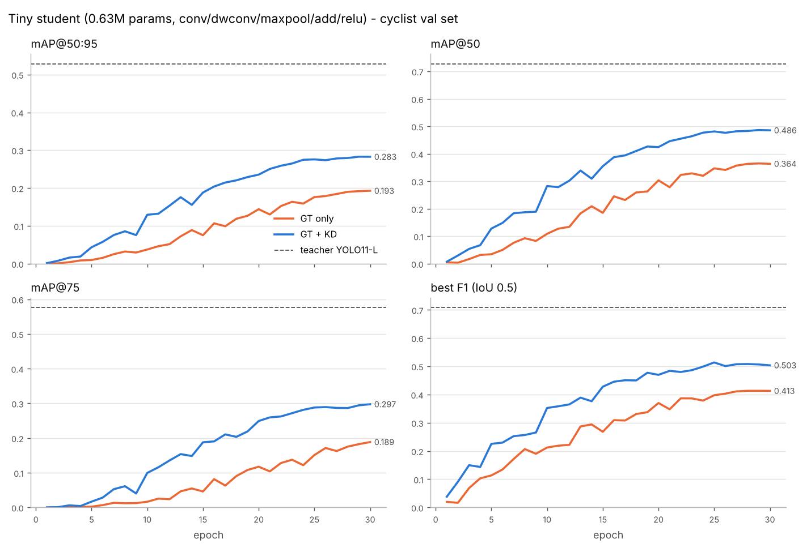

# Distillation YOLO → micro-détecteur « cyclist » (conv / dwconv / maxpool / add / relu)

Distillation d'un **YOLO11-L (25,3 M params)** vers un **élève de 0,63 M params / 0,75 GFLOPs @320**
n'utilisant que `Conv`, `Conv` depthwise, `MaxPool`, `AvgPool`, `Add`, `ReLU` (pas de concat, pas d'upsample,
pas de sigmoid/SiLU, pas de multiplication élément par élément), sur un subset COCO « cyclist ».
Deux entraînements strictement identiques (seed, ordre des données, augmentations, optimiseur, schedule, EMA) :
**GT seule** vs **GT + KD**, évalués à chaque epoch.



## Résultats (val : 610 images, 501 cyclistes, 320 px)

| modèle | params | mAP50-95 | mAP50 | mAP75 | F1 |
|---|---|---|---|---|---|
| Prof YOLO11-L (fine-tuné) | 25,3 M | 0,528 | 0,727 | 0,576 | 0,708 |
| Élève – GT seule | 0,63 M | 0,193 | 0,364 | 0,189 | 0,413 |
| **Élève – GT + KD** | 0,63 M | **0,283** | **0,486** | **0,297** | **0,503** |
| Gain KD | | **+0,090 (+47 %)** | **+0,122 (+34 %)** | **+0,108 (+57 %)** | +0,090 |

- Le gain est présent **à toutes les epochs** (de la 2e à la 30e), pas seulement en fin d'entraînement :
  tableau complet dans [`results/comparison.md`](results/comparison.md).
- L'élève KD atteint le score **final** de l'élève GT (0,193 mAP50-95) dès l'**epoch 16** (0,204) : ~2× plus efficace en epochs.
- L'élève récupère **54 % du mAP50-95 du prof** avec 2,5 % de ses paramètres (contre 37 % sans KD).
- Le gain relatif est le plus fort sur **mAP75** (+57 %) : la distillation de la distribution des boîtes (LD)
  améliore surtout la précision de localisation, ce que des cibles GT « one-hot » n'apprennent pas.
- Limite : un seul seed (CPU, ~7 h de calcul au total). L'écart (entre +0,067 et +0,120 de mAP50-95 sur chacune des 20 dernières epochs) est
  grand devant le bruit epoch à epoch, mais plusieurs seeds seraient nécessaires pour un intervalle de confiance.

## Ce qui fait marcher la distillation ici (et pourquoi elle échoue souvent)

1. **Un prof réellement bon sur la tâche cible.** Le premier fine-tuning (ultralytics `optimizer=auto` →
   AdamW + `warmup_bias_lr=0.1`) a **divergé** : la perte d'entraînement *montait*, mAP50 = 0,02.
   Avec Adam, un lr de biais de 0,1 détruit les biais BN pré-entraînés. Recette corrigée : SGD lr 0,005,
   warmup 1 epoch, `warmup_bias_lr=0` → mAP50 0,58 dès l'epoch 1. **Toujours évaluer le prof avant de distiller.**
2. **Sorties alignées ancre par ancre.** L'élève a exactement le format de tête du prof (DFL 16 bins, 1 classe,
   strides 8/16/32) → distillation dense directe, sans appariement heuristique.
3. **Même image augmentée pour le prof et l'élève** (mosaic, affine, HSV, flip) : le prof est exécuté en ligne
   sur le batch de l'élève. Distiller sur des sorties pré-calculées sur d'autres augmentations casse le signal.
4. **Trois termes complémentaires, normalisés pour ne pas écraser la perte GT** (`src/losses.py`) :
   - **KD classification** : BCE avec les scores sigmoïdes du prof comme cibles douces, modulée par
     `|p_t − p_s|^γ` (style QFL/BCKD, ICCV'23) et normalisée par la masse de premier plan du prof
     → les ~2000 ancres de fond faciles ne noient pas le signal.
   - **LD – Localization Distillation** (Zheng et al., CVPR'22) : KL entre distributions DFL prof/élève (T = 2),
     pondérée par la confiance du prof.
   - **PKD** (Cao et al., NeurIPS'22) : MSE entre features du neck standardisées par canal (corrélation de Pearson),
     via des adaptateurs 1×1 utilisés uniquement à l'entraînement. Insensible aux écarts d'amplitude entre
     architectures hétérogènes (C2f/attention vs dwconv/ReLU).
5. **Un évaluateur vérifié.** Mon premier évaluateur appariait détections/GT par IoU au lieu de la confiance
   → mAP sous-estimé de 8 points. Corrigé et validé contre **pycocotools** sur le prof
   (0,727 / 0,528 vs pycocotools 0,727 / 0,524).

## Élève : uniquement des ops autorisées

`src/student.py` : backbone MobileNetV2-like (inverted residual = pw → dw → pw + Add), « SPPF » remplacé par
`x + mp5(x) + mp5²(x) + mp5³(x)` (MaxPool + Add), neck PAN **bottom-up uniquement** (fusion par Add de convs
stride 2, aucune upsample ni concat), têtes découplées box/cls en dwconv séparables.
La BN est fusionnée dans les convs au déploiement. Le décodage DFL (softmax) et la sigmoïde de score sont du
post-traitement hors réseau, comme pour tout déploiement YOLO sur NPU.

Vérification (`src/export_check.py`) sur l'élève entraîné :
```
ONNX ops: {'Conv': 82, 'Relu': 65, 'Add': 12, 'MaxPool': 3} (of which depthwise Conv: 30)
ONLY allowed ops: True
```
→ [`results/student_kd.onnx`](results/student_kd.onnx), 6 sorties séparées (box/cls × P3/P4/P5), aucune concat.

## Données

COCO n'a pas de classe cyclist : `src/build_dataset.py` apparie personne ↔ vélo (recouvrement ≥ 20 % de la
personne, centre de la personne dans le vélo, tête au-dessus du vélo, appariement 1-1 glouton) et prend l'union
des deux boîtes. Les vélos garés et les piétons restent du fond (**négatifs durs**).
Train : 2123 images (1123 avec cyclistes + 1000 négatifs durs) ; val : 610 images (360 avec cyclistes, 501 boîtes).

## Reproduire

```bash
pip install torch torchvision ultralytics pycocotools onnx onnxruntime
python3 src/build_dataset.py          # télécharge annotations + images COCO -> data/cyclist
./run_all.sh                           # prof (6 ep) -> éval prof -> 2 élèves (30 ep) ; idempotent / reprenable
python3 src/compare.py                 # results/comparison.md + results/curves.png
python3 src/export_check.py results/student_kd.pt
```
`src/train_student.py --kd {none,full,logit,feat}` permet aussi les ablations logit-only / feature-only.

## Fichiers

| | |
|---|---|
| `src/student.py` | élève (contraintes d'ops) |
| `src/teacher.py` | wrapper prof ultralytics (sorties brutes + features du neck) |
| `src/losses.py` | perte YOLOv8/11 (TAL, BCE, CIoU, DFL) + KD (cls, LD, PKD) |
| `src/train_student.py` | entraînement GT / KD, checkpoint par epoch, `--resume` |
| `src/evaluate.py` | mAP50 / 50-95 / 75 style COCO (validé vs pycocotools) |
| `results/` | historiques par epoch, poids élèves, ONNX, courbes, comparaison |
